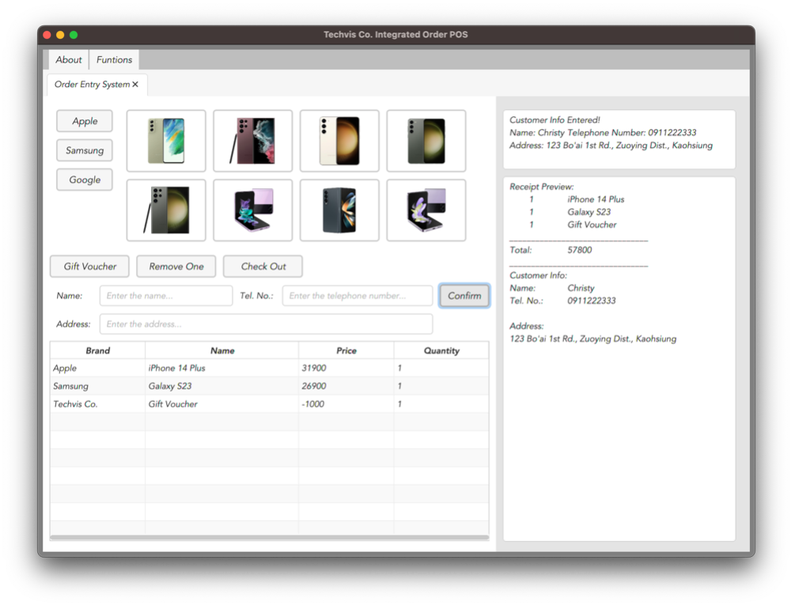
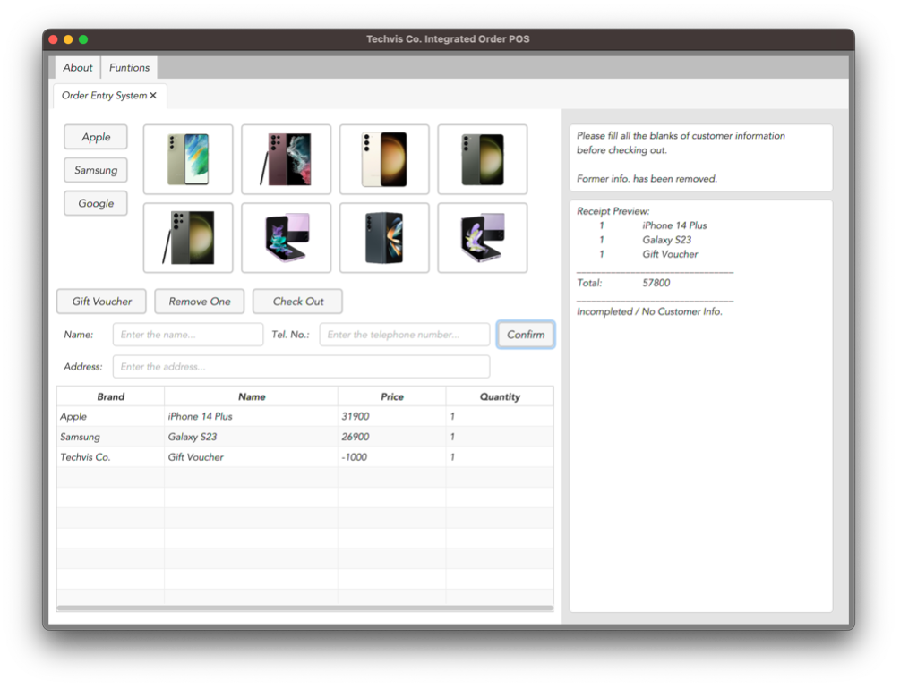
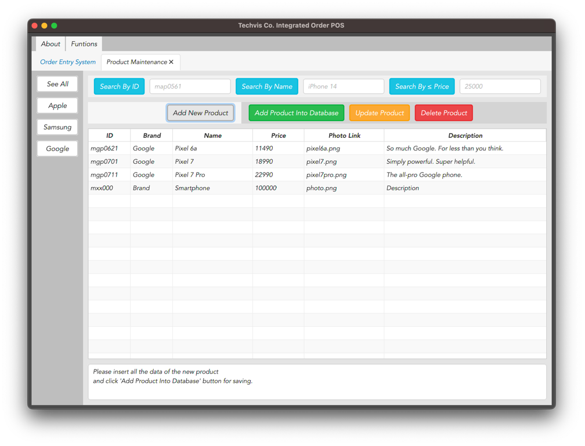
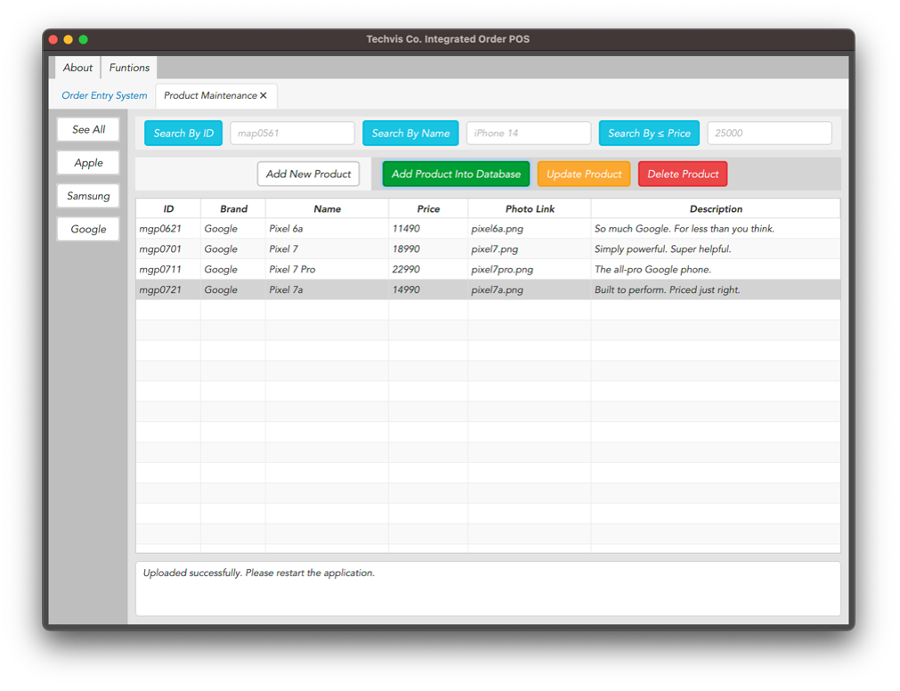
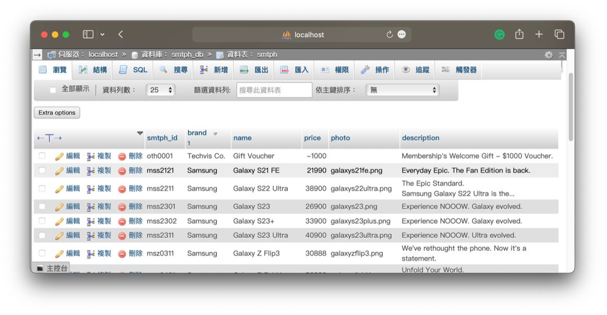
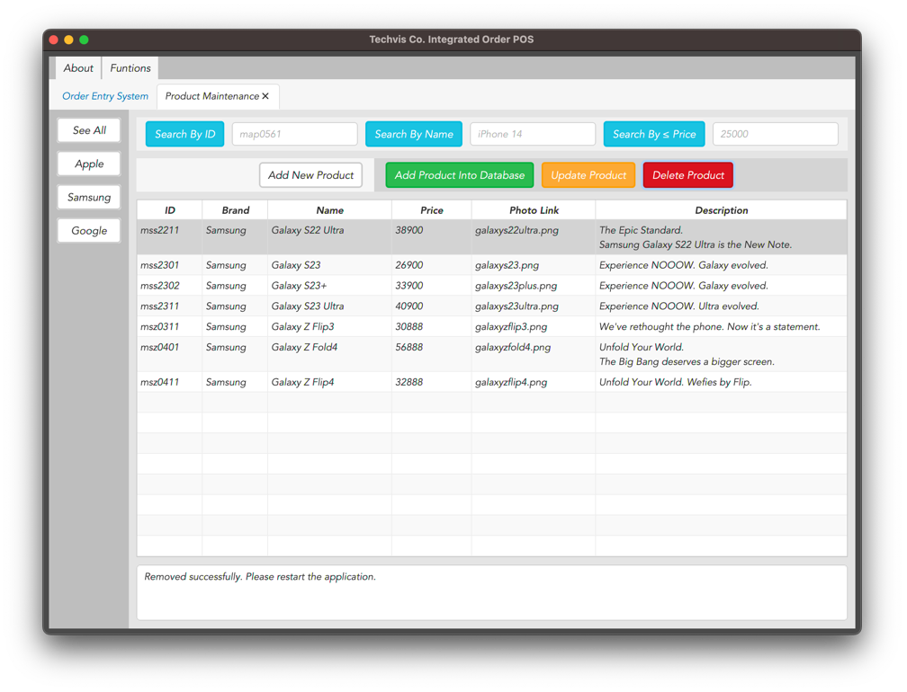
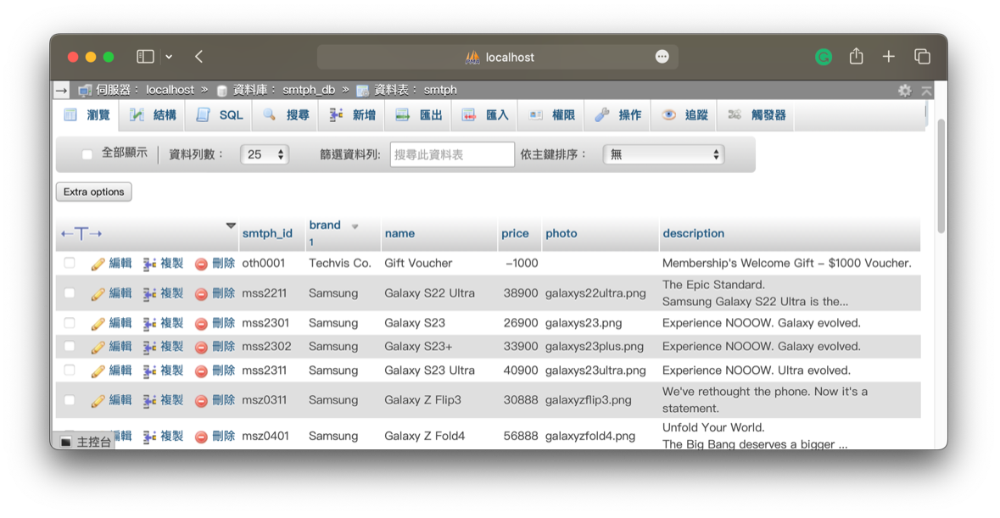
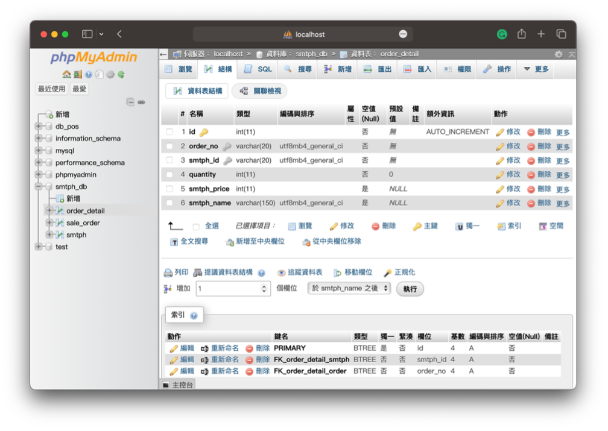
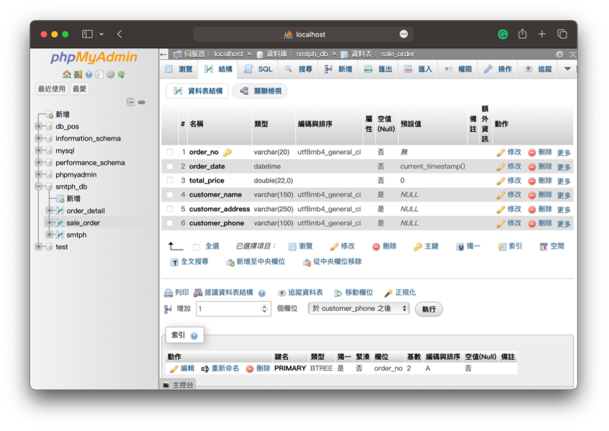
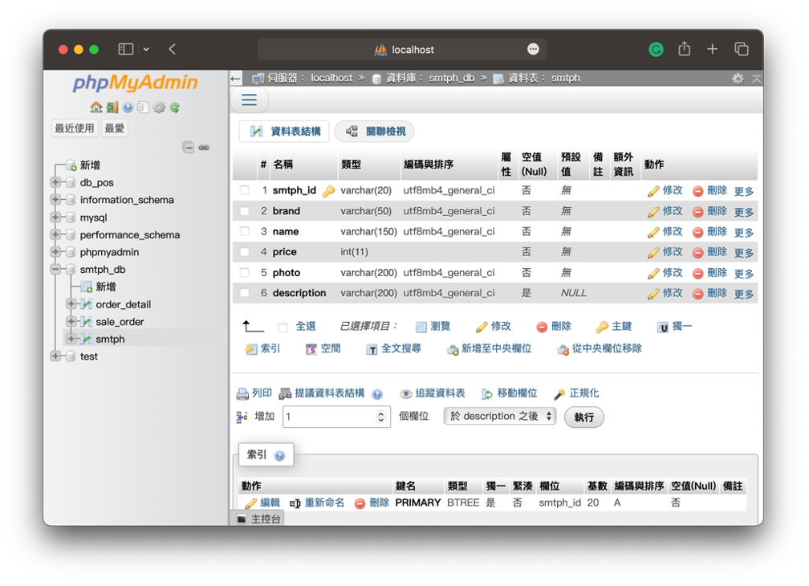

# Techvis Co. – Integrated POS System

A desktop Point of Sale (POS) application developed using JavaFX and MySQL. The system allows store employees to manage smartphone products, process customer orders, and maintain transaction records through a graphical user interface.

## Project Overview

Techvis Co. is a fictional smartphone retail business. This project was developed as an extension of an earlier JavaFX POS application, with a focus on database integration, product management, and order processing.

The application integrates multiple functions into a single desktop system, allowing employees to browse smartphone products, manage product information, process customer orders, and review daily order information. Product details and transaction records are stored in a MySQL database.

## Key Features

### 1. Order Management

- Browse smartphone products by brand, including Apple, Samsung, and Google.
- Add products to the shopping cart and adjust item quantities.
- Apply a gift voucher discount of $1,000.
- Display an order summary and receipt preview.
- Enter customer details, including name, phone number, and delivery address.
- Validate customer information before confirming an order.
- Generate a receipt as a text file during checkout.
- Save completed orders and their associated product details to the database.

### 2. Product Management

- Search for products by brand, product ID, name, or price.
- View product information in a table.
- Add new products to the database.
- Update existing product information.
- Delete products from the database.
- Display operation results and system messages through the interface.

### 3. Daily Order Analysis

- Access the daily order analysis module through the integrated application.
- Review order-related information through a dedicated analysis interface.

### 4. Database Integration

The application uses MySQL to store product information and order records. The database consists of three main tables:

| Table          | Description                                                                                   |
| -------------- | --------------------------------------------------------------------------------------------- |
| `smtph`        | Stores smartphone information, including brand, name, price, image filename, and description. |
| `sale_order`   | Stores order information, including order date, total price, and customer details.            |
| `order_detail` | Stores the products and quantities associated with each order.                                |

Primary keys and foreign keys are used to establish relationships between the tables and maintain connections between orders and their product details.

## Technologies Used

- **Programming Language:** Java
- **GUI Framework:** JavaFX (Programmatic UI Development)
- **UI Styling:** JavaFX CSS
- **Database:** MySQL
- **Query Language:** SQL
- **Database Connectivity:** MariaDB JDBC Driver
- **Database Management:** XAMPP / phpMyAdmin
- **IDE:** Apache NetBeans

## Application Structure

The main application class is `integ.mergedAPPv1`, located in `src/integ/mergedAPPv1.java`.

It integrates the following modules into a single JavaFX application:

| Module               | Description                                |
| -------------------- | ------------------------------------------ |
| Order Entry System   | Handles customer orders and checkout.      |
| Product Maintenance  | Supports product searching and management. |
| Daily Order Analysis | Provides access to daily order analysis.   |
| About This System    | Displays system information.               |

The graphical user interface is built programmatically using JavaFX components, with CSS stylesheets applied to customise the visual appearance and styling of the interface. The project does not use Scene Builder or FXML.

## Screenshots

Screenshots below demonstrate the main functions and interface of the application.

### Order Entry System

&#x20; 

The interface displays the selected products, shopping cart, customer details, and receipt preview. Employees can review the order before completing the checkout process.

### Customer Information Validation

&#x20; 

The system checks whether all required customer information has been provided. If any fields are incomplete, a warning message is displayed.

### Product Maintenance

&#x20; 

This interface allows employees to search for smartphone products by ID, name, or price. Products can also be filtered by brand and displayed in a table for easier management.

### Add Product

&#x20; 

Employees can enter the details of a new smartphone and add it to the database. A confirmation message is displayed when the product has been successfully added.

### Product Management

&#x20; 

&#x20; 

&#x20; 

Employees can select an existing product (e.g. Galaxy S21 FE) and remove it from the database. The system displays a confirmation message after the deletion is completed.

### Database Structure

&#x20; 

This table stores the products associated with each order, including product IDs, quantities, prices, and names. Foreign keys link each record to the corresponding order and product.

&#x20; 

This table stores order records, including order dates, total prices, and customer information such as names, phone numbers, and delivery addresses.

&#x20; 

This table stores smartphone product information, including product IDs, brands, names, prices, image filenames, and descriptions.

## How to Run

### Prerequisites

- Java JDK compatible with the project's configuration
- Apache NetBeans IDE
- XAMPP or another compatible MySQL server
- MariaDB JDBC Driver
- JavaFX libraries required by the project

### Setup Instructions

**1. Download or clone the repository**

Download the project files or clone this repository to your local machine.

**2. Open the project in NetBeans**

- Launch Apache NetBeans IDE.
- Select `File` → `Open Project`.
- Navigate to the downloaded project folder.
- Open the entire project folder, rather than individual Java files.

**3. Set up the database**

- Start MySQL using XAMPP.
- Open phpMyAdmin at `http://localhost/phpmyadmin`.
- Import the SQL script `smtph_db.sql` to create the database and its tables.
- Ensure the database connection settings in the project match your local MySQL configuration.

**4. Configure the main application**

The main application class is:

`integ.mergedAPPv1`

If necessary, configure this class as the Main Class in the NetBeans project settings.

**5. Run the application**

Right-click the project in NetBeans and select **Run**, or press `F6`.

Make sure the JavaFX libraries, JDBC driver, and database connection are configured correctly before running the application.

### Important Notes

- The SQL setup script contains a `DROP DATABASE IF EXISTS` statement. Back up any existing database named `smtph_db` before importing the script.
- Database connection settings may need to be adjusted for your local environment.
- Ensure that the required CSS files, images, and other project resources are included when downloading the repository.

## What I Learned

Through this project, I gained practical experience in:

- Independently designing and developing desktop application interfaces using JavaFX.
- Applying JavaFX CSS to customise interface styling and visual presentation.
- Building graphical user interfaces programmatically.
- Handling user interactions and JavaFX event handling.
- Connecting a Java application to a MySQL database using JDBC.
- Performing database operations, including creating, retrieving, updating, and deleting records (CRUD).
- Designing relational database tables using primary keys and foreign keys.
- Implementing input validation and handling incomplete customer information.
- Integrating product management and order processing into one application.

## Additional Documentation

A detailed project documentation in Traditional Chinese (繁體中文) is also available in Microsoft Word format.

📄 [View Traditional Chinese Documentation](docs/Techvis-Co-Project-Documentation-zh-TW.docx)

## Project Information

- **Project Type:** Academic / Individual Project
- **Course:** Object-Oriented Programming
- **Institution:** National Kaohsiung University of Science and Technology (NKUST)
- **Completion Date:** June 2023

---

*This project was developed for academic purposes as a demonstration of JavaFX application development and relational database integration.*
